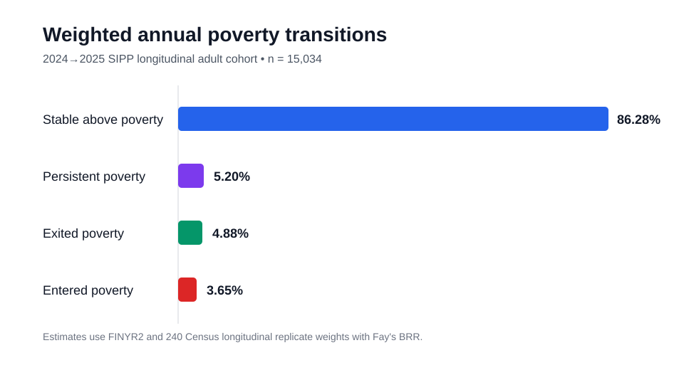
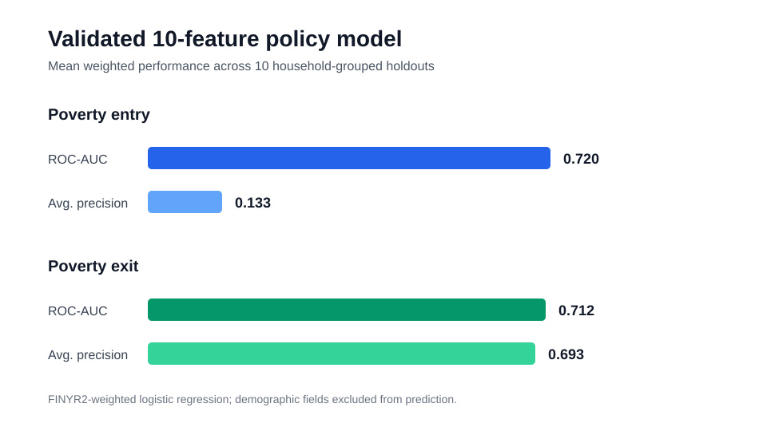
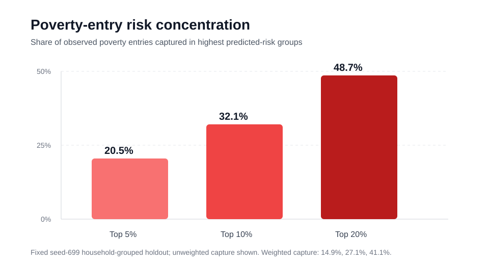

# SIPP Economic Stability & Poverty Transitions

A longitudinal public-policy analysis using the U.S. Census Bureau Survey of Income and Program Participation (SIPP) to study how adults move into and out of poverty over time.

The project is designed as a methodological companion to the NHIS Healthcare Access Analysis, but it answers a different kind of question: **what happens next?**

Rather than classifying a cross-sectional outcome measured at the same time as its predictors, the SIPP design preserves temporal ordering by using baseline characteristics to study economic status in a subsequent survey year.


## Project snapshot

- **15,034** adults in the validated two-year longitudinal cohort
- **4.05%** poverty-entry rate among adults above poverty at baseline
- **48.43%** poverty-exit rate among adults below poverty at baseline
- **240** Census longitudinal replicate weights used for Fay-BRR uncertainty
- **10-feature** preferred policy-facing model
- weighted ROC-AUC: **0.720** for poverty entry and **0.712** for poverty exit
- demographics excluded from prediction and retained for subgroup auditing only

[Read the executive summary](docs/EXECUTIVE_SUMMARY.md)







## Primary research question

> Which baseline economic, employment, demographic, and safety-net characteristics are associated with entering or exiting poverty over time among U.S. adults observed longitudinally in SIPP?

## Initial longitudinal design

The first analytical cohort uses respondents represented in both the **2024 and 2025 SIPP releases**.

- 2024 SIPP: reference period January–December 2023
- 2025 SIPP: reference period January–December 2024
- Census 2-year longitudinal weight: respondents with data in both releases
- Census 2-year longitudinal replicate weights: variance estimation for that same cohort

The project uses the Census longitudinal design rather than substituting cross-sectional survey weights for transition estimates.

## Primary outcomes

The initial annual transition framework defines four mutually exclusive states:

```text
above poverty → above poverty    stable_above_poverty
above poverty → poverty          entered_poverty
poverty       → above poverty    exited_poverty
poverty       → poverty          persistent_poverty
```

The analysis uses the official annual family income-to-poverty ratio `TFCYINCPOV`, with poverty defined as a ratio below 1.0.

## Why SIPP

SIPP is specifically designed to measure changes in:

- income
- employment
- program participation
- health insurance
- assets and liabilities
- family and household composition
- material hardship
- economic well-being

Its longitudinal structure makes it possible to study **transitions and persistence**, not just one-time differences between groups.

## Methodological roadmap

### Population analysis

Estimate nationally representative transition rates using the Census two-year longitudinal weight.

Completed outputs include:

- overall poverty-entry rate
- overall poverty-exit rate
- persistent poverty
- stable-above-poverty prevalence
- longitudinal replicate-weight uncertainty

### Prospective prediction

Baseline-year characteristics will be used to predict following-year outcomes.

Model families evaluated:

1. prevalence-only baseline
2. regularized logistic regression
3. histogram gradient-boosting benchmark

Completed evaluation includes:

- ROC-AUC
- average precision
- Brier score
- log loss
- calibration
- risk concentration
- subgroup diagnostics
- repeated subgroup validation
- feature ablation

Predictive models will be treated as **prospective risk-ranking tools**, not causal models.

## Candidate baseline domains

Potential predictor domains include:

- employment and labor-force status
- earned and unearned income
- public-program participation
- health insurance
- education
- household and family structure
- disability
- assets and liabilities
- nativity
- demographic characteristics

Predictor definitions and timing are validated against the registered Census schemas before modeling.

## Survey inference

This project will explicitly separate descriptive population inference from predictive modeling.

Population estimates will use:

- Census two-year longitudinal weights
- Census longitudinal replicate weights
- documented replicate-weight variance estimation

Predictive models may use longitudinal weights as sample weights where appropriate, but model coefficients and machine-learning feature effects will not automatically be interpreted as population-causal estimates.

## Data architecture

The repository separates source registration, asset discovery, downloading, validation, and analysis:

```text
official Census release pages
          ↓
source registry
          ↓
asset discovery
          ↓
downloads + checksums
          ↓
schema validation
          ↓
2024 / 2025 person records
          ↓
longitudinal linkage
          ↓
2-year weights + replicate weights
          ↓
transition outcomes
          ↓
population inference + prospective modeling
```

Large raw Census files will not be committed to Git history.

## Current milestone

### Milestone 3 — longitudinal cohort construction
**Complete**

The official 2024 and 2025 SIPP primary files have now been linked to the Census two-year longitudinal and replicate-weight files.

Validated panel profile:

| Measure | Result |
| --- | ---: |
| 2024 unique persons | 36,915 |
| 2025 unique persons | 32,052 |
| Linked persons with longitudinal weights | 18,207 |
| Adult analytical cohort | **15,034** |

Design-based longitudinal estimates:

| Estimand | Estimate | SE | 95% CI |
| --- | ---: | ---: | ---: |
| Stable above poverty | **86.28%** | 0.40 pp | 85.50–87.06% |
| Entered poverty | **3.65%** | 0.22 pp | 3.21–4.08% |
| Exited poverty | **4.88%** | 0.26 pp | 4.37–5.38% |
| Persistent poverty | **5.20%** | 0.22 pp | 4.76–5.63% |
| Baseline poverty prevalence | **10.07%** | 0.33 pp | 9.42–10.72% |
| Follow-up poverty prevalence | **8.84%** | 0.31 pp | 8.24–9.44% |
| Poverty entry among baseline nonpoor adults | **4.05%** | 0.25 pp | 3.57–4.54% |
| Poverty exit among baseline poor adults | **48.43%** | 1.72 pp | 45.06–51.81% |

Standard errors and confidence intervals use all 240 Census longitudinal replicate weights with Fay's BRR method.

The panel builder validates annual-variable consistency across monthly SIPP records, links on `SSUID + PNUM`, checks `FINYR2` against `REPWGT0`, and writes the person-level panel outside Git history.

See [`docs/PANEL_CONSTRUCTION.md`](docs/PANEL_CONSTRUCTION.md), [`docs/TRANSITION_ANALYSIS.md`](docs/TRANSITION_ANALYSIS.md), and [`data/metadata/panel_profile.json`](data/metadata/panel_profile.json).

## Planned milestones

### Milestone 1 — longitudinal design and source foundation
**Complete**

Research design, source provenance, transition-state logic, and reproducible source discovery.

### Milestone 2 — verified data acquisition
**Complete**

Verified official asset registry, downloader, checksum generation, remote probing, and schema validation.

### Milestone 3 — longitudinal cohort construction
**Complete**

Validated person-year collapse, `SSUID + PNUM` linkage, adult analytical cohort, longitudinal-weight integration, replicate full-weight validation, and transition-state construction.

### Milestone 4 — poverty transition analysis
**Complete**

The official annual family poverty ratio is selected, transition outcomes are constructed, and the survey-inference pipeline estimates weighted rates, Fay-BRR standard errors, and bounded 95% confidence intervals from `REPWGT1`–`REPWGT240`.

The dedicated workflow rebuilds the panel from official Census assets before producing `data/metadata/transition_analysis.json`. The full-data workflow and the standard quality-check workflow both pass successfully.

### Milestone 5 — prospective prediction
**Complete**

The baseline predictor contract is frozen in `config/predictors.json` and validated against both registered Census primary-file schemas. After a full-data profiling pass, universe-dependent assistance fields were refined before modeling; the current contract contains **19 baseline features**.

The feature builder streams the 2024 person-month file, constructs the leakage-safe baseline matrix, and preserves the full **15,034-person** analytical cohort. Modeling samples are:

- poverty entry: **13,464 adults**, 587 entries
- poverty exit: **1,570 adults**, 757 exits

The first household-grouped holdout benchmark is now complete:

| Task | Model | ROC-AUC | Average precision | Brier score | Log loss |
| --- | --- | ---: | ---: | ---: | ---: |
| Poverty entry | Prevalence only | 0.500 | 0.046 | 0.0439 | 0.1866 |
| Poverty entry | Regularized logistic | **0.724** | **0.176** | **0.0413** | **0.1703** |
| Poverty exit | Prevalence only | 0.500 | 0.516 | 0.2518 | 0.6968 |
| Poverty exit | Regularized logistic | **0.724** | **0.719** | **0.2135** | **0.6160** |

Train/test separation is grouped by `SSUID`, so members of the same sampled household cannot appear on opposite sides of the holdout.

Repeated household-grouped validation, weighted sensitivity analysis, probability calibration, and a gradient-boosting benchmark are now complete.

Across 10 household-grouped holdouts, the weighted logistic model averages ROC-AUC **0.718** for poverty entry and **0.706** for poverty exit. Gradient boosting raises weighted entry ROC-AUC to **0.743**, but slightly reduces entry average precision; for poverty exit, logistic regression remains better across ROC-AUC, average precision, Brier score, and log loss.

A separate group-aware sigmoid-calibration analysis did not improve overall probability accuracy, so the project retains the raw logistic probabilities.

Current model-selection conclusion:

- **poverty exit:** regularized logistic regression remains the preferred benchmark
- **poverty entry:** logistic regression remains the interpretable benchmark, with histogram gradient boosting retained as a nonlinear challenger

Policy-facing diagnostics are now implemented on the fixed household-grouped holdout. For poverty entry, the highest-risk **10%** contains **32.1%** of observed entries (**27.1%** after longitudinal weighting), while the highest-risk 20% contains **48.7%** (**41.1% weighted**).

Subgroup diagnostics also identify review signals—for example, weighted entry discrimination varies substantially across some age bands. These are treated as prompts for repeated-split fairness analysis rather than definitive subgroup conclusions because some cells have limited positive events.

Repeated subgroup validation is now complete across the same 10 household-grouped holdouts. Persistent review signals remain—for example, weighted poverty-entry ROC-AUC averages **0.661** for ages 18–29 versus **0.759** for ages 45–59, while weighted poverty-exit ROC-AUC averages **0.620** for ages 75+ versus **0.754** for ages 60–74. Sex-group discrimination is comparatively similar across repeated splits.

The repository reports these as model-review signals, not causal or fairness conclusions, and suppresses subgroup headlines that lack repeated event support.

Feature-ablation sensitivity is now complete. Removing the demographic predictor block slightly improves both tasks, and removing the asset block has essentially no cost. A combined **10-feature lean specification** improves all four weighted metrics relative to the full 19-feature logistic model.

The preferred policy-facing candidate is now defined in `config/policy_model.json`:

- demographics are retained for subgroup auditing but excluded from risk-score fitting
- asset variables are excluded for negligible incremental value
- education, employment, income, housing, and safety-net variables remain predictive inputs

The lean model raises weighted entry ROC-AUC from **0.718 to 0.720** and exit ROC-AUC from **0.706 to 0.712**, while also improving average precision, Brier score, and log loss on both tasks.

The 10-feature lean specification has now passed its own repeated validation and subgroup audit and is promoted as the preferred policy-facing logistic benchmark.

Across 10 household-grouped holdouts, the validated policy model averages:

| Task | Weighted ROC-AUC | Weighted average precision | Brier score | Log loss |
| --- | ---: | ---: | ---: | ---: |
| Poverty entry | **0.720** | **0.133** | **0.0394** | **0.1640** |
| Poverty exit | **0.712** | **0.693** | **0.2170** | **0.6251** |

Demographic variables remain available for subgroup auditing but are excluded from risk-score fitting. Asset variables are also excluded because repeated ablation showed negligible incremental value.

Milestone 5 is complete: the repository now contains a reproducible baseline model, repeated validation, weighted sensitivity analysis, calibration testing, nonlinear benchmarking, risk concentration, subgroup auditing, repeated subgroup validation, feature ablation, and a validated policy-facing specification.

### Optional extensions

The core longitudinal analysis and predictive modeling workflow are complete.

Future extensions could include:

- independent R validation of representative longitudinal estimates
- event-history models for monthly transitions
- material-hardship outcomes
- three- or four-year longitudinal cohorts
- external validation on a later SIPP release

## Responsible interpretation

This is an observational analysis.

The project will not interpret associations as causal effects of government programs or demographic characteristics.

Nativity may be examined descriptively, but SIPP does not identify refugees and foreign-born respondents will **not** be treated as a refugee proxy.

## Repository structure

```text
.
├── .github/workflows/
│   ├── baseline-models.yml
│   ├── boosting-benchmark.yml
│   ├── feature-ablation.yml
│   ├── feature-profile.yml
│   ├── model-calibration.yml
│   ├── model-validation.yml
│   ├── policy-diagnostics.yml
│   ├── policy-model-validation.yml
│   ├── subgroup-validation.yml
│   ├── panel-profile.yml
│   ├── quality-checks.yml
│   └── transition-analysis.yml
├── config/
│   ├── assets.json
│   ├── policy_model.json
│   ├── predictors.json
│   └── source_registry.json
├── data/
│   ├── metadata/
│   │   ├── baseline_models.json
│   │   ├── boosting_benchmark.json
│   │   ├── calibration_analysis.json
│   │   ├── feature_ablation.json
│   │   ├── feature_profile.json
│   │   ├── model_validation.json
│   │   ├── policy_diagnostics.json
│   │   ├── policy_model_subgroups.json
│   │   ├── policy_model_validation.json
│   │   ├── subgroup_validation.json
│   │   ├── panel_profile.json
│   │   └── transition_analysis.json
│   ├── processed/
│   └── raw/
├── docs/
│   ├── ACQUISITION.md
│   ├── EXECUTIVE_SUMMARY.md
│   ├── BASELINE_MODELING.md
│   ├── DATA_SOURCES.md
│   ├── FEATURE_ABLATION.md
│   ├── MODEL_SELECTION.md
│   ├── MODEL_VALIDATION.md
│   ├── POLICY_DIAGNOSTICS.md
│   ├── PANEL_CONSTRUCTION.md
│   ├── RESEARCH_DESIGN.md
│   ├── TRANSITION_ANALYSIS.md
│   ├── VARIABLES.md
│   └── figures/
├── src/
│   ├── analyze_transitions.py
│   ├── assets.py
│   ├── benchmark_boosting.py
│   ├── build_features.py
│   ├── build_panel.py
│   ├── feature_ablation.py
│   ├── calibrate_models.py
│   ├── audit_policy_model.py
│   ├── policy_diagnostics.py
│   ├── cohort.py
│   ├── download_assets.py
│   ├── registry.py
│   ├── source_discovery.py
│   ├── validate_schemas.py
│   └── verify_remote_assets.py
├── tests/
│   ├── test_baseline_models.py
│   ├── test_feature_builder.py
│   ├── test_milestone1.py
│   ├── test_milestone2.py
│   ├── test_milestone3.py
│   └── test_milestone4.py
├── .gitignore
├── requirements.txt
└── README.md
```

## Run locally

Create an environment and install the current dependencies:

```bash
python3 -m venv .venv
source .venv/bin/activate
python -m pip install --upgrade pip
python -m pip install -r requirements.txt
```

Run tests:

```bash
python -m pytest -q
```

Discover candidate assets from the registered official Census pages:

```bash
python src/source_discovery.py
```

The discovery output is written to:

```text
data/metadata/discovered_assets.json
```

After the full Census assets have been downloaded and the panel has been built, construct the baseline feature matrix:

```bash
python src/build_features.py
```

Then run the replicate-weight transition analysis:

```bash
python src/analyze_transitions.py
```


Validate the preferred policy-facing model:

```bash
python src/validate_policy_model.py
python src/audit_policy_model.py
```

No analytical microdata are committed to Git history.
